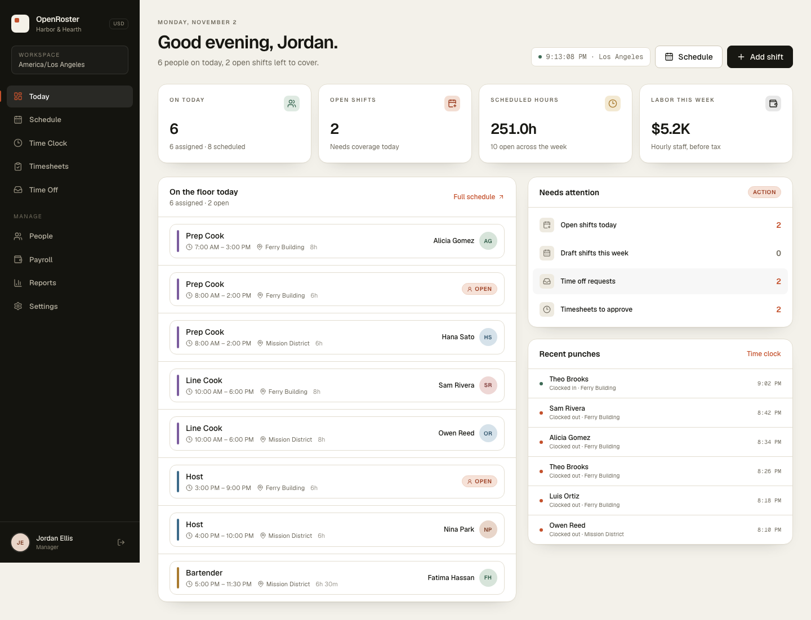
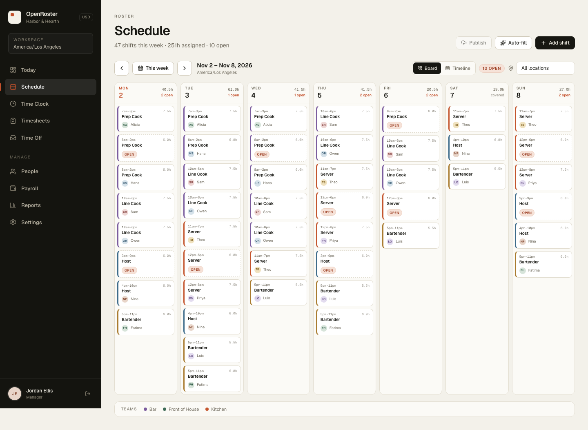

# OpenRoster

**Workforce management for small teams.** Scheduling, time clock, timesheets, time off and payroll in one calm, self-hosted workspace.

Built for restaurants, clinics and shops that run on real shifts. One PocketBase binary, one Next.js app, SQLite. No per-seat cloud.



## Why this exists

[TimeTrex](https://github.com/timetrex/TimeTrex) has deep payroll and time & attendance, but it is an AGPL PHP/Zend Framework monolith. [Staffjoy](https://github.com/Staffjoy/v2) had a clean scheduling model, but its v2 stack (Go + Bazel + Kubernetes) is deprecated and V1 is a Python microservice constellation.

OpenRoster borrows the *ideas* — Staffjoy's company/location/team/worker model and TimeTrex's punch → timesheet → pay-run pipeline — and implements them from scratch. No TimeTrex code is used. The repo is MIT.

## What v1 does

- **Schedule** — week board and hour-by-hour timeline, location filter, draft/publish, realtime updates, overlap validation.
- **Auto-fill** — assigns open shifts using availability, approved time off, existing shifts, weekly hour caps and position fit. It leaves genuinely uncovered shifts open instead of guessing.
- **Time clock** — clock in/out from the web, kiosk mode for managers, live “on the clock” list, duplicate-punch protection.
- **Timesheets** — generated from punches (scheduled hours are a fallback), daily and weekly overtime, PTO, approve individually or in bulk.
- **Payroll** — preview and draft runs from approved timesheets, configurable percent/fixed rules, per-stub breakdown, pay history, mark paid.
- **People** — profiles, pay, availability, documents, PTO balance, recent punches.
- **Time off** — requests, approve/deny queue, balances.
- **Reports** — scheduled vs actual hours, labor by department, coverage, overtime watch.
- **Settings** — company, locations, departments, positions, pay rules, holidays, role-based access, audit log.

Staff see their own schedule, clock, timesheet and time off. Managers see the company. Admins manage roles and company settings.



## Stack

```
Browser
  │  PocketBase JS SDK (REST + realtime)
  ▼
Next.js 16 / React 19        PocketBase 0.40 (Go)
  port 3000        ───────►  port 8097
                             SQLite + auth + files
                             pb_hooks: clock, auto-fill,
                             timesheets, payroll, audit
```

There is **no extra API layer**. PocketBase is the backend and enforces access with collection rules. The Next app is a client-rendered product surface. Heavy domain logic lives in `pb/pb_hooks/main.pb.js` and `pb/pb_hooks/lib.js`.

## Quick start (local)

Requirements: Node 22+, npm, and `curl`/`unzip`.

```bash
make setup                 # download PocketBase + npm install
make admin                 # create superuser admin@openroster.local / OpenRoster123!
make dev-pb                # terminal 1 — http://127.0.0.1:8097
make seed                  # terminal 2 — demo company + punches + timesheets
make dev-web               # terminal 3 — http://127.0.0.1:3000
```

If PocketBase is not on the default port, copy `web/.env.example` to `web/.env.local` and change `NEXT_PUBLIC_PB_URL`.

### Demo accounts

| Role | Email | Password |
|---|---|---|
| Administrator | `maya@harborhearth.co` | `OpenRoster123!` |
| Manager | `jordan@harborhearth.co` | `OpenRoster123!` |
| Team member | `sam@harborhearth.co` | `OpenRoster123!` |

The seed creates “Harbor & Hearth”, two locations, 12 people, two weeks of shifts, punches for today, generated timesheets and a draft pay run. It is date-relative, so it always lands in the current week.

> **Change the superuser password** with `ADMIN_PASSWORD=... make admin` before exposing the app.

## Docker

```bash
NEXT_PUBLIC_PB_URL=http://localhost:8097 docker compose up --build
```

Then create the superuser and seed from the host:

```bash
docker compose exec pocketbase pocketbase superuser upsert admin@openroster.local 'change-me' --dir=/pb_data
PB_URL=http://127.0.0.1:8097 PB_SUPERUSER=admin@openroster.local PB_SUPERUSER_PASSWORD=change-me node scripts/seed.mjs
```

Open http://localhost:3000. The PocketBase dashboard is at http://localhost:8097/_/.

`NEXT_PUBLIC_PB_URL` is baked into the browser bundle at image build time, so set it to the URL the **browser** will use (not a Docker-internal hostname). For production, put both services behind HTTPS and keep the PocketBase dashboard private.

## Data model

| Collection | Purpose |
|---|---|
| `companies`, `locations`, `departments`, `positions` | Org structure |
| `users` (auth) | Login + role: `admin`, `manager`, `employee` |
| `employees` | Profile, pay type/rate, max hours, PTO, manager |
| `availability` | Repeating weekly windows |
| `time_off_requests` | Vacation/sick/unpaid, approval state |
| `shifts` | Assigned or open, draft/published, breaks |
| `punches` | In/out events with source and optional location |
| `timesheets`, `timesheet_entries` | Period totals and daily detail |
| `pay_runs`, `pay_stubs` | Draft/paid runs and per-person breakdowns |
| `pay_rules` | Percent / per-hour / per-period withholdings and contributions |
| `holidays`, `documents` | Calendar and HR files |
| `audit_log` | Manager actions on shifts, people and pay runs |

Schema lives in `pb/pb_migrations/`. Access rules are part of the schema: employees can read their own records, managers their company, admins everything.

## How scheduling works

`POST /api/openroster/schedule/auto` loads every open shift in the week, then scores each active hourly employee:

- hard filters: approved time off, overlapping shift, weekly hour cap, location, availability window (if any are defined)
- score: position match, department match, location match, fairness (fewer scheduled hours wins), overtime risk, same-day continuity

The client sends per-day UTC offsets for the company timezone, because PocketBase's JS runtime has no `Intl`. Only empty shifts are touched, and nothing is assigned if no one passes the hard filters.

## How pay is calculated

1. Approved timesheets are selected for the period. Salaried staff are included without a timesheet.
2. Hourly: `regular hours × rate`, `overtime hours × rate × multiplier`, plus PTO.
3. Salary: annual rate prorated by calendar days in the period.
4. Each active `pay_rule` adds a withholding or employer contribution: percent of gross, fixed per hour, or fixed per period.
5. Net = gross − employee taxes − employee deductions. Employer taxes are reported as cost, not withheld.
6. Creating a run writes `pay_runs` + `pay_stubs` in a draft. Marking it paid also marks the period's timesheets paid.

## Scope boundaries (read this)

OpenRoster is a complete workflow, not a compliance product.

- **Not a tax engine.** Pay rules are flat rates you configure. There are no federal/state withholding tables, wage-base caps, reciprocity, or filings. Verify every rate and consult a payroll provider before paying people.
- **No payments.** No direct deposit, checks, or provider integration.
- **Single tenant.** One company per install. Multi-tenant isolation is not implemented.
- **SQLite / PocketBase scale.** Excellent for a few hundred staff and modest concurrency; not a distributed enterprise system.
- **Geofence fields are stored, not enforced.** Latitude/longitude/radius exist on locations and punches, but clock-in does not reject out-of-radius punches.
- **PTO balance is informational.** Approving time off adds PTO hours to the timesheet but does not decrement the employee balance automatically.
- **No shift swaps, open-shift marketplace, push notifications, or mobile app.**
- **Salary proration uses calendar days**, not a payroll calendar. `pay_frequency` is stored but not used for exact salary splits.
- **Auto-fill uses client-computed timezone offsets** for the selected week. That is correct across the week, including DST changes.
- **No automated email/SMS.** PocketBase email settings are available but not configured.
- **Tests are smoke tests, not a suite.** The flows were exercised against a live PocketBase instance; there is no CI yet.

## Project layout

```
pb/
  pb_migrations/        schema, rules, indexes, timestamps
  pb_hooks/main.pb.js   routes + validation + audit
  pb_hooks/lib.js       shared domain helpers
web/
  src/app/(app)/        Today, Schedule, Time Clock, Timesheets, Requests,
                        People, Payroll, Reports, Settings
  src/components/       UI system, schedule, clock, modals
  src/lib/              PocketBase client, auth, types, date/format helpers
scripts/
  seed.mjs              date-relative demo company
  fetch-pocketbase.sh   pinned binary download
docs/                   screenshots
```

## Attribution

- Scheduling/product model inspired by **Staffjoy V2** (MIT) and **Staffjoy Suite** (MIT-licensed per repo; original autoscheduler in Julia).
- Time & attendance / payroll pipeline inspired by **TimeTrex** (AGPL-3.0). **No TimeTrex code is included or linked**, so this project stays MIT.
- Built with [PocketBase](https://pocketbase.io) (MIT), [Next.js](https://nextjs.org) (MIT), [date-fns](https://date-fns.org) (MIT) and [Lucide](https://lucide.dev) (ISC).

## License

MIT. See [LICENSE](LICENSE).
